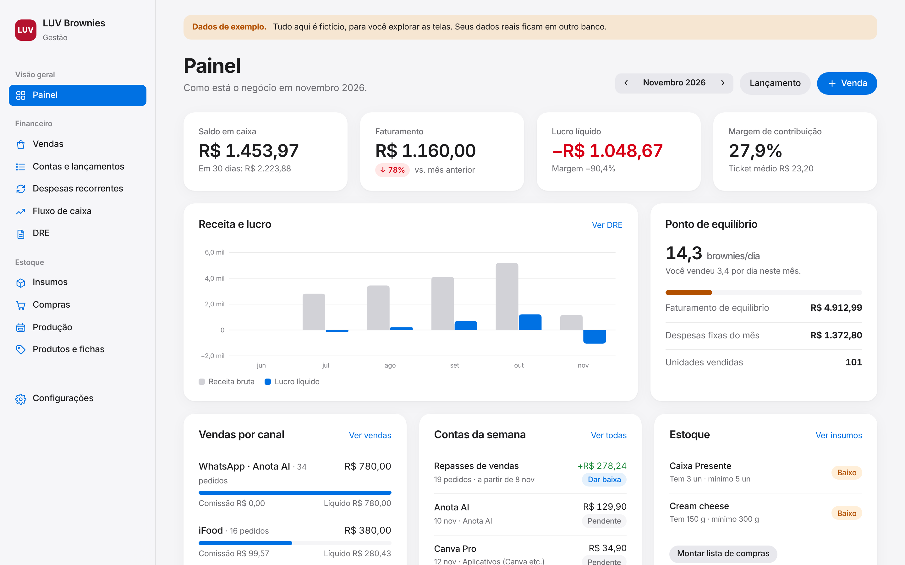

# LUV · Gestão

Ferramenta de gestão da LUV Brownies, em Python. Roda no seu computador e guarda tudo num arquivo SQLite.



## Começando

```bash
cd gestao
python3 -m venv .venv
source .venv/bin/activate        # no Windows: .venv\Scripts\activate
pip install -r requirements.txt
python run.py --demo             # explore com dados fictícios
python run.py                    # seus dados reais
```

O navegador abre em http://127.0.0.1:5000. Os bancos ficam em `gestao/dados/`: `luv.db` (real) e `demo.db` (exemplo). Para fazer backup, copie `luv.db`. Para abrir no celular dentro da rede de casa: `python run.py --host 0.0.0.0` e acesse o IP do computador. Rodando assim, no seu computador, não pede senha. Para usar pela internet, com senha, veja [PUBLICAR.md](PUBLICAR.md).

## O que tem

**Financeiro**
- **Vendas**: canal, produtos, desconto. A comissão vem do canal (iFood 23% + 3,2% já cadastrados). Cada venda baixa o estoque, grava o custo dos produtos (CMV) e lança o recebimento no caixa: na hora no WhatsApp, em 30 dias no iFood (ajuste o prazo do seu contrato em Configurações). Kits (Dupla, Caixa Presente) pedem os sabores na hora da venda.
- **Contas e lançamentos**: contas a pagar e a receber, despesas e outras receitas. Filtros por status, categoria e data. Baixa em lote para quando o repasse do iFood chega num Pix só. Exporta CSV.
- **Despesas recorrentes**: Anota AI, internet, anúncios, DAS… gera os lançamentos do mês com um clique, sem duplicar.
- **Fluxo de caixa**: diário (realizado até hoje, previsto pelos vencimentos depois) e anual por atividade (operacional, investimentos, sócios). Saldo por conta.
- **DRE**: mês com comparação ao anterior e análise vertical, ou o ano mês a mês. Mostra margem de contribuição, ponto de equilíbrio em R$ e em brownies por dia.

**Estoque**
- **Insumos**: saldo, mínimo, custo médio ponderado, valor parado, alerta de reposição e lista de compras sugerida.
- **Compras**: entram no estoque, atualizam o custo médio e geram a saída no caixa (à vista ou com vencimento).
- **Produção**: cada fornada baixa os insumos da ficha técnica e põe os brownies no estoque com o custo real do lote. Avisa se falta insumo.
- **Produtos e fichas técnicas**: custo por unidade, markup e quanto sobra em cada canal depois da comissão.
- Ajustes: perda, contagem de inventário e entrada avulsa.

## Como os números são calculados

A DRE segue o regime de competência:

```
Receita bruta              vendas + outras receitas
(−) Deduções               descontos, DAS, reembolsos (Chegou Inteiro)
= Receita líquida
(−) CMV                    insumos e embalagens dos produtos vendidos + perdas + custos variáveis lançados
= Lucro bruto
(−) Despesas variáveis     comissões e taxas dos canais, entregas
= Margem de contribuição
(−) Despesas fixas         Anota AI, anúncios, energia, pró-labore…
= Resultado operacional
(±) Resultado financeiro
= Lucro líquido
```

- Compra de insumo não é despesa do mês: vai para o estoque e vira custo quando o brownie é vendido.
- Investimentos (equipamentos), aportes e retiradas só aparecem no fluxo de caixa.
- Ponto de equilíbrio = despesas fixas ÷ margem de contribuição (%).
- O fluxo de caixa usa a data de pagamento. O que está pendente entra como previsto no vencimento, e o atrasado entra como previsto para hoje.

## Primeiros passos com dados reais

1. **Configurações**: confira as contas (saldo inicial de cada uma), o prazo de repasse do iFood e as categorias.
2. **Insumos**: cadastre ingredientes e embalagens com o estoque atual e o custo de referência.
3. **Produtos e fichas**: monte a receita de cada brownie e o rendimento. Nos kits, a ficha é só a embalagem.
4. **Despesas recorrentes**: cadastre as contas fixas e gere o mês.
5. No dia a dia: compras, produção e vendas. O painel e a DRE se montam sozinhos.

O banco real começa só com a estrutura (canais, categorias e o cardápio com os preços do plano). Nenhum número de venda ou custo vem preenchido.

## Código

```
run.py                     inicia o servidor
luv/schema.sql             tabelas (dinheiro em centavos)
luv/services/estoque.py    custo médio, compras, produção, ajustes
luv/services/vendas.py     venda, comissão, CMV e recebimento
luv/services/financeiro.py lançamentos, fluxo de caixa e DRE
luv/routes/                telas (Flask)
luv/templates/             HTML (Jinja)
luv/static/                CSS e JS, sem dependências externas
luv/charts.py              gráficos em SVG gerados no servidor
luv/seed.py                estrutura inicial e dados de exemplo
tests/                     pytest
```

Testes:

```bash
pip install -r requirements-dev.txt
pytest
```
